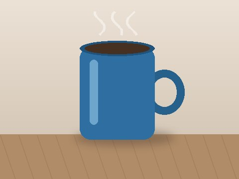
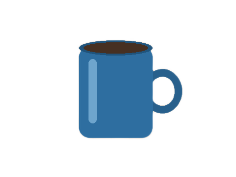

# ✂ 이미지 백그라운드 제거

사진을 올리면 배경을 지우고 **투명 PNG**로 돌려주는 웹앱입니다.
여러 장을 한 번에 올릴 수 있고, 결과를 한 장씩 또는 ZIP으로 받을 수 있어요.

**바로 써 보기: <https://hotmericano.github.io/img_background_remover/>**

- **서버가 필요 없어요.** 모든 계산이 브라우저 안에서 일어나서, 사진이 어디로도 전송되지 않습니다.
- **GPU로 돌아가요.** TensorFlow.js가 WebGL로 신경망을 실행합니다.
- **휴대폰에서도 동작해요.** 메모리가 부족하면 가벼운 모델로 자동 전환됩니다.
- **여백을 자동으로 잘라 줘요.** 물체 크기에 딱 맞는 PNG를 받을 수 있어요. 원본 크기 그대로 받을 수도 있습니다.

| 원본 | 결과 |
| --- | --- |
|  |  |

## 실행하기

`index.html`을 더블클릭해서 열면 **동작하지 않아요.**
페이지가 `fetch()`로 모델 파일을 읽는데, 브라우저는 보안 때문에 `file://` 주소에서 파일을 읽는 것을 막습니다.
그래서 간단한 로컬 서버를 띄워서 열어야 해요.

```bash
git clone https://github.com/Hotmericano/img_background_remover.git
cd img_background_remover
python3 -m http.server 8000
```

브라우저에서 <http://localhost:8000> 을 열면 됩니다.

### GitHub Pages로 배포하기

저장소를 fork해서 내 계정에 배포하고 싶을 때 따라 하세요.

1. 이 저장소를 fork합니다.
2. 저장소의 **Settings → Pages**로 갑니다.
3. **Source**를 `Deploy from a branch`, 브랜치를 `main` / `(root)`로 정하고 저장합니다.
4. 1~2분 뒤 `https://<내 아이디>.github.io/img_background_remover/` 에서 열립니다.

## 사용법

1. 사진을 끌어다 놓거나, 눌러서 고르거나, `Ctrl+V`로 붙여넣습니다. 휴대폰에서는 탭해서 앨범에서 고르면 돼요.
2. 오른쪽 위에서 모델을 고릅니다.

   | 모델 | 크기 | 특징 |
   | --- | --- | --- |
   | 정밀 (silueta) | 44MB | 경계가 더 깔끔해요. PC 기본값 |
   | 빠름 (U²-Netp) | 4.5MB | 가볍고 빨라요. 휴대폰 기본값 |

3. 필요하면 결과 모양을 고릅니다. 처리가 끝난 뒤에 바꿔도 바로 반영돼요.

   | 옵션 | 선택지 | 설명 |
   | --- | --- | --- |
   | 미리보기 배경 | 투명 / 흰색 | 흰색을 고르면 흰 배경 PNG로 저장돼요 |
   | 여백 | 자르기 / 원본 크기 | 자르기(기본값)는 물체 주변의 투명한 여백을 잘라내요 |

4. 결과 카드의 **PNG 저장**이나 위쪽의 **전체 저장 (ZIP)** 을 누릅니다.

처음 한 번은 모델을 내려받고 GPU 셰이더를 준비하느라 몇 초 걸려요. 그 다음부터는 한 장에 보통 1초 안팎입니다.

## 동작 원리

```
사진 ──► 320×320으로 축소 ──► 정규화 ──► U²-Net ──► 확률 지도(0~1)
     ──► 원본 크기로 확대 ──► 알파 채널로 합성 ──► 여백 자르기 ──► PNG
```

1. **전처리**: 사진을 320×320으로 줄이고, 픽셀 값을 가장 밝은 값으로 나눈 뒤 ImageNet 평균·표준편차로 정규화합니다. 모델이 학습할 때 본 것과 같은 형태로 맞추는 과정이에요.
2. **추론**: [U²-Net](https://github.com/xuebinqin/U-2-Net)은 사진에서 가장 눈에 띄는 물체(salient object)를 찾는 신경망입니다. 픽셀마다 "주인공일 확률"을 출력해요.
3. **후처리**: 확률 지도를 0~1로 다시 늘린 뒤 원본 크기로 키웁니다. 이 값을 각 픽셀의 투명도로 쓰면 경계가 부드럽게 빠집니다. 캔버스의 `destination-in` 합성 모드를 쓰면 이 단계가 한 줄로 끝나요.
4. **여백 자르기**: 알파 값이 10/255보다 큰 픽셀 중 가장 위·아래·왼쪽·오른쪽 좌표를 찾아서(바운딩 박스) 그 사각형만 남깁니다. 기준값을 0이 아니라 10으로 두는 이유는, 모델 결과에서 배경 픽셀이 정확히 0이 아니라 1~5 정도로 남는 경우가 있어서예요. 원본 크기 결과와 자른 결과를 둘 다 만들어 두기 때문에, 처리 후에 옵션을 바꿔도 다시 계산하지 않아요.

### 왜 ONNX Runtime을 안 쓰고 직접 변환했나요?

배경 제거 모델은 보통 ONNX 형식으로 배포되고, 브라우저에서는 `onnxruntime-web`으로 실행하는 게 일반적입니다.
이 프로젝트는 처음에 외부 CDN에서 `.wasm` 파일을 받을 수 없는 환경에서 만들어져서, 다른 방법을 택했어요.

- `tools/convert.py`가 ONNX 파일(사실은 protobuf)을 **직접 파싱**합니다.
- 신경망 구조를 `conv`, `pool`, `up`(업샘플), `cat`(이어붙이기), `add`, `sig`(시그모이드) 6가지 연산의 목록으로 단순화해서 `models/*.json`에 저장합니다.
- 브라우저의 `engine.js`가 이 목록을 순서대로 읽으면서 TensorFlow.js 연산으로 실행합니다.

그래서 `engine.js`는 100줄도 안 되는 짧은 코드예요. 신경망 추론이 결국 **행렬 연산을 정해진 순서대로 실행하는 것**이라는 걸 직접 볼 수 있어요.

### 가중치 파일 이름이 왜 `.wasm`인가요?

내용은 WebAssembly가 아니라 그냥 숫자 배열(바이너리)입니다.
처음 배포한 호스팅이 `.bin` 같은 임의의 확장자를 받아 주지 않아서, 바이너리를 그대로 서빙해 주는 `.wasm` 확장자를 빌려 썼어요.
파일 하나가 15MB를 넘지 않도록 쪼갠 것도 같은 이유입니다.

## 폴더 구조

```
img_background_remover/
├── index.html          # 앱 전체 (HTML + CSS + JS + 추론 엔진이 한 파일에)
├── models/
│   ├── u2netp.json     # 빠름 모델의 연산 목록
│   ├── u2netp.0.wasm   # 빠름 모델 가중치 (float32)
│   ├── silueta.json    # 정밀 모델의 연산 목록
│   └── silueta.*.wasm  # 정밀 모델 가중치 (uint8, 3개로 분할)
├── tools/              # 모델 변환과 검증용 스크립트
│   ├── onnxparse.py    # 의존성 없는 최소 ONNX(protobuf) 파서
│   ├── convert.py      # ONNX → models/*.json + 가중치
│   ├── ref.py          # 원본 ONNX를 numpy로 그대로 실행 (정답 기준)
│   ├── simp.py         # 변환된 그래프를 numpy로 실행
│   ├── engine.js       # index.html에 들어 있는 추론 엔진 원본
│   ├── mocktf.js       # 테스트용 가짜 TensorFlow.js (순수 JS 구현)
│   ├── test.js         # engine.js를 Node에서 실행
│   └── verify.py       # 위 결과들을 서로 비교
└── docs/               # README용 예시 이미지
```

## 모델 다시 변환하기 (선택)

`models/`에 변환된 파일이 이미 있으니 앱을 쓰는 데는 필요 없어요. 변환 과정을 직접 해 보고 싶을 때만 따라 하세요.
Python 3와 numpy, Node.js가 필요합니다.

```bash
cd tools

# 1) rembg 프로젝트가 배포하는 원본 ONNX 모델 받기
curl -L -o u2netp.onnx  https://github.com/danielgatis/rembg/releases/download/v0.0.0/u2netp.onnx
curl -L -o silueta.onnx https://github.com/danielgatis/rembg/releases/download/v0.0.0/silueta.onnx

# 2) 변환
python3 convert.py u2netp.onnx  ../models u2netp
python3 convert.py silueta.onnx ../models silueta

# 3) 검증: 원본 ↔ 변환 그래프 ↔ engine.js 결과 비교
python3 verify.py u2netp u2netp.onnx
```

`verify.py`를 돌리면 이런 결과가 나옵니다.

```
[원본 ONNX vs 변환 그래프] 최대 오차 0.00e+00
[변환 그래프 vs engine.js] 최대 오차 4.54e-07
```

silueta는 원본이 **양자화된(quantized) 모델**이에요. 원본은 계산할 때마다 중간값을 8비트로 줄였다가 되돌리는데, 변환할 때는 가중치만 복원하고 이 과정을 생략했습니다. 그래서 원본과 결과가 조금(최대 약 0.16) 다르지만, 정밀도를 덜 잃는 쪽이라 품질은 비슷하거나 더 낫습니다.

> 받은 `.onnx` 파일은 용량이 커서 저장소에 올리지 않아요. `.gitignore`에 `*.onnx`가 이미 들어 있어서 실수로 커밋되지 않습니다.

## 알려진 한계

- **"주인공"이 하나인 사진**에 맞춰진 모델이라, 물체가 여러 개이거나 배경과 색이 비슷하면 결과가 덜 깔끔할 수 있어요.
- 머리카락처럼 아주 가는 경계는 320×320 해상도에서 예측하기 때문에 뭉개질 수 있습니다.
- 결과 이미지 최대 크기는 PC 약 1600만 화소, 휴대폰 약 500만 화소예요(브라우저 캔버스 메모리 한도 때문). 이보다 큰 사진은 줄여서 처리합니다.
- 여백 자르기는 물체를 하나의 사각형으로 감싸요. 물체에서 떨어진 곳에 배경이 조금 남으면 그 부분까지 포함해서 잘릴 수 있어요. 그럴 땐 "원본 크기"로 받아 주세요.
- WebGL을 쓸 수 없는 브라우저에서는 CPU로 계산해서 많이 느려요.

## 사용한 것들

- [U²-Net](https://github.com/xuebinqin/U-2-Net) (Xuebin Qin 외) — 모델 구조와 U²-Netp 가중치
- [rembg](https://github.com/danielgatis/rembg) (Daniel Gatis) — ONNX로 변환된 u2netp / silueta 모델, 전처리 방식
- [TensorFlow.js](https://github.com/tensorflow/tfjs) — 브라우저 GPU 연산
- [JSZip](https://github.com/Stuk/jszip) — 여러 장을 ZIP으로 묶기

## 라이선스

이 저장소의 코드에 붙일 라이선스는 직접 정해 주세요. 잘 모르겠으면 MIT가 무난합니다.
가중치와 라이브러리는 각 원작자의 라이선스를 따릅니다. 올리기 전에 위 링크에서 직접 확인하세요.
